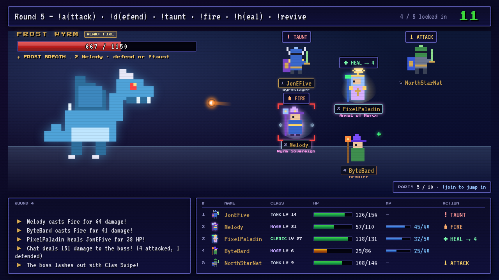
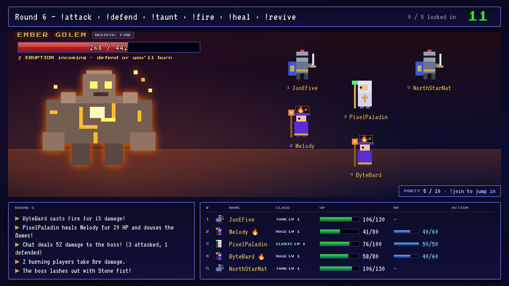
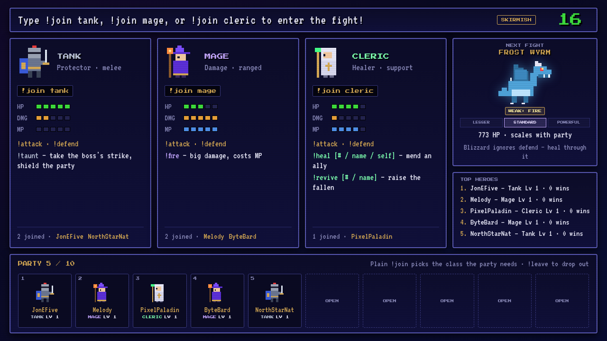
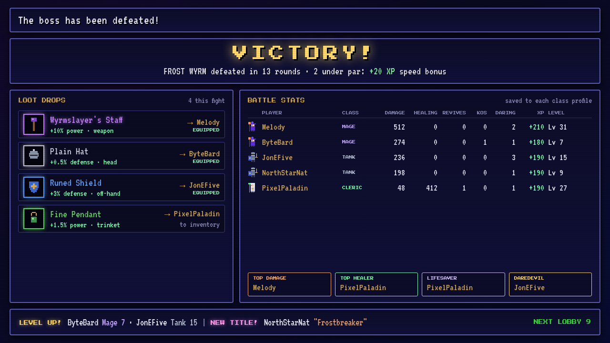
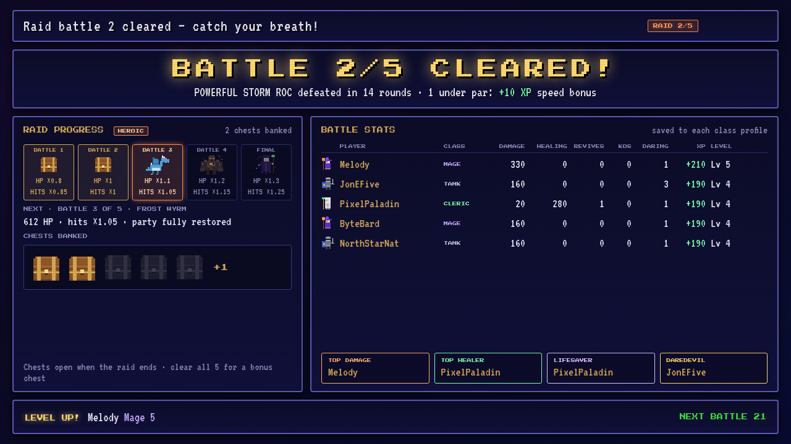
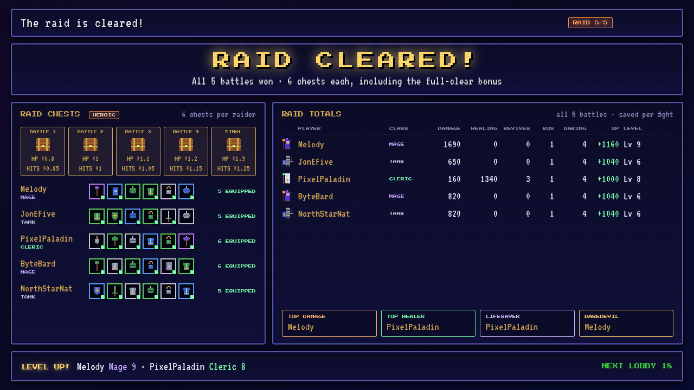

# Twitch Chat Boss Fight

A collaborative, round-based boss fight that your Twitch chat plays together.
Viewers join a party as a Tank, Mage or Cleric and type commands like `!attack`,
`!defend` or `!heal` in chat. Once per round the game resolves everyone's choice
at once, and a JRPG-style battle screen shows the result on stream.



The battle screen is a browser page you add to OBS as a Browser Source. The game
runs on your own computer as a small Node.js server that reads your Twitch chat.

---

## How it plays

- **Rounds, not spam.** Each round, chat has 15 seconds to choose an action. Only
  each viewer's **last** command before the round locks counts, so typing faster
  or more often does nothing. Anyone who doesn't choose defends.
- **The boss tells you what's coming.** Before anyone commits, the boss announces
  its next move, such as a breath attack on a named player, a power attack
  wind-up or a counter. The skill is reading the warning and choosing well.
- **Everyone has their own HP.** A player's choices decide whether *they*
  survive. Fallen players can be revived by a Cleric.
- **Anyone can join any fight.** The boss scales to the party that actually
  joined, so a solo viewer and a party of ten both get a fight of about 15 rounds
  (about five minutes). Veterans make the boss tougher rather than easier.

## Features

### Three classes

| Class | Role | Signature commands |
| --- | --- | --- |
| **Tank** | Protector | `!taunt`: take the boss's targeted strike and soften area hits for the party |
| **Mage** | Damage | `!fire`: big damage for MP |
| **Cleric** | Healer | `!heal [slot / name / self]`, `!revive [slot / name]` |

Everyone can `!attack` and `!defend`. Defending blocks 90% of most hits and
recovers a little HP, which keeps healer-less parties alive.

### Four bosses

Each skirmish picks a boss at random (never the same one twice in a row), and
each boss has its own backdrop, a signature move and an elemental weakness or
resistance.

| Boss | Weak / resists | Signature move |
| --- | --- | --- |
| **Frost Wyrm** | weak to fire | *Blizzard* hits everyone and ignores defend: heal through it |
| **Ember Golem** | resists fire | *Eruption* sets anyone who didn't defend on fire for a few rounds; a Cleric's heal puts it out |
| **Shadow Lich** | weak to holy (Cleric attacks) | *Hex of Decay* drains one player every round until a Cleric heals them |
| **Storm Roc** | weak to physical | *Chain Lightning* arcs through a row of neighboring players; the marked slots defend |



Parties without a Cleric face a gentler **Lesser** boss, and parties of
seasoned players face a **Powerful** one with extra targets and an earlier
enrage.

### Progression and loot

- **XP and levels per class.** Every round you act earns XP, win or lose; wins
  add a bonus, more for beating par. Levels raise your HP, damage and healing,
  up to +30% at level 50. Past that, levels keep counting as bragging rights.
- **Gear drops** after a win: weapons add power, armor adds defense. Better
  items are equipped automatically and drawn on your character's sprite (green,
  blue or purple for uncommon, rare and epic).
- **Results screen** after every fight: loot, damage/healing stats, badges (Top
  Damage, Top Healer, Lifesaver, Daredevil) and level-ups. A **Top Heroes**
  leaderboard shows in the lobby.

| Lobby | Victory screen |
| --- | --- |
|  |  |

Progress is saved in a local SQLite database (`data/bossfight.db`), keyed by
Twitch user ID, so it survives name changes and server restarts.

### Raids

Five battles in a row against a shuffled lineup of all four bosses, getting
harder each battle. Classes lock for the whole raid. Each battle won banks a
chest, and clearing all five adds a bonus chest. When the raid ends, every
raider who stuck it out opens them all.

A raid's tier (**Normal**, **Heroic** or **Mythic**) follows the party's
strength. Higher tiers pay out better chests, and nobody is ever kept out.

| Between raid battles | Raid cleared |
| --- | --- |
|  |  |

Mods start raids with `!raid`, or can let chat vote one in with `!raidvote`.

### Tools for running a stream

Mods can pause the game, skip ahead, end a battle (players keep the XP
they earned), remove someone, or pick the next boss. Streamers can start each
battle themselves (manual mode), call **last call** so the queue plays out
before the game closes, or close the game entirely between segments. See the
[command reference](#chat-commands) below.

## Project status

Phases 1–8 of the project are built:

- the core round loop
- classes and targeted heals/revives
- party management with a queue
- persistence
- level and gear power
- gear drops
- raids
- multiple bosses with raid tiers

Phase 8 (the new bosses and raid tiers) is awaiting playtesting.

Still to come:

- **Web companion app (Phase 9):** log in with Twitch to see your XP progress,
  stats and inventory, and choose your gear between streams.
- **Real pixel art.** Every sprite is placeholder art drawn in code for now.

Ideas further out include a crowd-cheer meter for spectators, seasonal bosses
and earnable titles.

---

## Setup

### 1. Prerequisites

- **Node.js 22.13 or later.** The game uses Node's built-in SQLite module. Check
  with `node --version`, and install from https://nodejs.org if needed.
- **A Twitch account for the bot.** This can be your own streaming account, or
  (recommended, so bot messages don't look like they're from you) a second free
  Twitch account created just for this.

### 2. Install dependencies

Open a terminal in the `twitch-boss-fight` folder and run:

```bash
npm install
```

### 3. Register a Twitch application

1. Go to https://dev.twitch.tv/console and log in with your main Twitch account.
2. Click **Register Your Application**.
3. Fill in:
   - **Name**: anything unique, e.g. "YourChannel Boss Fight"
   - **OAuth Redirect URLs**: exactly `http://localhost:3001/oauth/callback`
     (used only by the one-time setup script below)
   - **Category**: "Chat Bot" or "Application Integration"
4. Save it. You'll see a **Client ID**, and can generate a **Client Secret** on
   the same page. Treat the secret like a password.

### 4. Configure your environment

```bash
cp .env.example .env
```

Open `.env` and fill in:

- `TWITCH_CLIENT_ID` / `TWITCH_CLIENT_SECRET`: from step 3
- `TWITCH_BOT_USERNAME`: the bot account's Twitch username
- `TWITCH_CHANNEL`: your channel name, lowercase, no `#`
- `TWITCH_REDIRECT_URI`: leave the default unless you changed it in step 3
- `PORT`: leave as `3000` unless that port is in use
- Leave `TWITCH_REFRESH_TOKEN` blank; the next step fills it in

`.env` holds your credentials and is never committed to git.

### 5. Get the bot's refresh token (one time)

```bash
npm run get-token
```

This prints an authorization URL. Before opening it:

1. In your browser, **log in to Twitch as your bot account**. Whichever account
   is logged in when you click Authorize is the one the bot will act as.
2. Open the printed URL and click **Authorize**.
3. The terminal prints a line like `TWITCH_REFRESH_TOKEN=abcd1234...`. Copy that
   whole line into `.env`.

You only do this once; the server refreshes its own access token from then on.

### 6. Run the server

```bash
npm start
```

You should see:

```
Overlay server running at http://localhost:3000/overlay.html
Connected to Twitch chat, channel: your_channel_name
```

### 7. Add the overlay to OBS

1. In OBS, add a **Browser Source**.
2. URL: `http://localhost:3000/overlay.html`
3. Width × height: **1280 × 720**.
4. Leave "Shutdown source when not visible" **unchecked**, so the overlay stays
   connected when you switch scenes.

The overlay is a full-frame scene with its own dark backdrop, so it works best
as its own scene or a large window in your layout. It reloads itself whenever
the server restarts, so OBS never runs stale code.

### Try it without Twitch

```bash
npm run offline
```

Offline mode skips Twitch and saves to a separate database (`data/offline.db`),
so test players never touch real profiles. Type fake chat into the server's
terminal as `<name> <message>`, e.g. `Melody !join mage`, or send it over HTTP:

```bash
curl -X POST localhost:3000/dev/chat -H 'Content-Type: application/json' \
  -d '{"user":"Melody","message":"!join mage"}'
```

Fake users count as mods, so mod commands work too.

---

## Chat commands

The lobby counts down 20 seconds after the first `!join`, then the battle starts.

### Player commands

| Command | What it does |
| --- | --- |
| `!join [tank\|mage\|cleric]` | Join the lobby (or the queue, if a fight is on or the party is full). Plain `!join` picks the class the party needs; joining again in the lobby switches class. |
| `!leave` (or `!flee`) | Drop out of the lobby or queue, or flee the fight in progress. XP for rounds already fought is kept; a raider who leaves forfeits the raid's chests. |
| `!attack`, `!defend` | Everyone. |
| `!taunt` | Tank: take the boss's targeted strike and shield the party. |
| `!fire` | Mage: big damage, costs MP. |
| `!heal [slot / name / self]`, `!revive [slot / name]` | Cleric. With no target, heals go to whoever needs it most (burning or hexed players first). |
| `!raidvote` | Vote to make this lobby a raid (only while a mod has voting on). |

### Mod / broadcaster commands

| Command | What it does |
| --- | --- |
| `!startbattle` | Start the battle now (lobby), or the next raid battle (intermission). |
| `!skip` | Move on now: start the battle, resolve the current round, or leave the results / intermission screen. Also lifts a pause. |
| `!pause` / `!resume` | Freeze / unfreeze whatever countdown is running (lobby, round, intermission, results). Players can still lock in actions while paused. |
| `!endbattle` | Call off the fight in progress (or the raid). Everyone keeps the XP for rounds fought; a raid opens the chests banked so far. No loot for a called-off skirmish. |
| `!boss <name>` / `!boss random` | Choose the next skirmish's boss (`wyrm`, `golem`, `lich`, `roc`): right away in a skirmish lobby, otherwise for the next one. Raids use their own lineup. |
| `!kick <name or slot>` | Remove someone from the lobby, queue, fight or raid. They can `!join` again from the next lobby. |
| `!raid` | Turn the open lobby into a raid lobby, or queue a raid for after the current fight. |
| `!endraid` | Cancel a queued raid, turn a raid lobby back into a skirmish lobby, or end a running raid. |
| `!enableraidvote` / `!disableraidvote` | Let chat start raids with `!raidvote` (off by default). |
| `!manualmode` / `!automode` | Manual: lobbies don't count down; the overlay shows STANDBY until a mod types `!startbattle` (or `!skip`). Auto (default): lobbies start on their own. |
| `!closequeue` | Last call: no new joins, but everyone already in the lobby or queue still gets to play. Once the queue is empty and the last battle ends, the game closes. |
| `!closegame` | Close now: no new joins and the queue is cleared. An open lobby closes immediately; a fight or raid in progress plays out first (`!endbattle` to stop it now). |
| `!opengame` | Reopen: starts a fresh lobby when closed, or cancels a last call / pending close. |

While the game is closed, the overlay shows a "The Wyrm Sleeps" card with the
leaderboard and `!join` is ignored. To have the server start closed (so nothing
runs before you go live), set `GAME_OPEN_ON_START: false` in
`src/gameConfig.js`; `MANUAL_START_DEFAULT: true` likewise starts in manual
mode. Changes made with chat commands reset to these defaults when the server
restarts.

---

## Tuning and balance

Every number lives in `src/gameConfig.js`: class stats, boss damage and move
weights, timers, XP curve, loot odds, raid stages and tiers. Change a value and
restart the server.

Balance is measured rather than guessed. `scripts/balance-sim.js` plays
hundreds of fights through the real game logic with scripted "chat" styles
(sensible, sloppy, risky) and reports fight length, KOs, revives and wipe rates:

```bash
node scripts/balance-sim.js --boss all              # every boss, every party
node scripts/balance-sim.js --raid --only TMC       # raid clear rates
node scripts/balance-sim.js --set BURN_DAMAGE=10    # try a value without editing the config
```

## Project layout

```
src/
  gameConfig.js   all tunable numbers
  fight.js        core round resolution (no Twitch/web dependencies)
  bosses.js       boss names, move names, elements and biomes
  bossMoves.js    the boss's announced move selection
  gameLoop.js     phases, timers, raids, stream controls; broadcasts state
  power.js        level + gear → player power
  loot.js         gear drops
  progress.js     SQLite persistence: XP, levels, stats, items
  server.js       web server, Socket.IO and the Twitch chat connection
  twitchAuth.js   access-token refresh
  devChat.js      offline mode's fake chat
public/
  overlay.html/.css/.js   the OBS overlay (battle, lobby, results screens)
  sprites.js              placeholder pixel art drawn as SVG
scripts/
  get-twitch-token.js     one-time OAuth setup
  balance-sim.js          balance simulator
  screenshot.js           headless overlay screenshots (npm run screenshot)
```

## Troubleshooting

- **"Failed to connect to Twitch chat" / token refresh errors:** check
  `TWITCH_CLIENT_ID`, `TWITCH_CLIENT_SECRET` and `TWITCH_REFRESH_TOKEN` in
  `.env`. If the refresh token was revoked (e.g. you removed the app's access in
  your Twitch settings), run `npm run get-token` again.
- **`npm run get-token` fails or the redirect never completes:** the redirect
  URI must match *exactly* (including `http://` and the port) between
  `TWITCH_REDIRECT_URI` in `.env` and the URL registered in the Twitch developer
  console.
- **The server won't start with a `node:sqlite` error:** your Node.js is too
  old; install 22.13 or later.
- **Overlay is blank in OBS:** make sure the server is still running (closing
  its terminal stops it) and the Browser Source URL is exactly
  `http://localhost:3000/overlay.html`.
- **Commands aren't registering:** commands are case-insensitive but must start
  the message (`!attack`, `!join mage`, `!startbattle`, ...).
